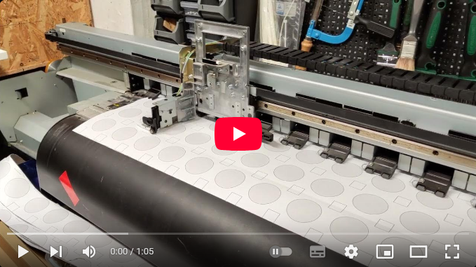
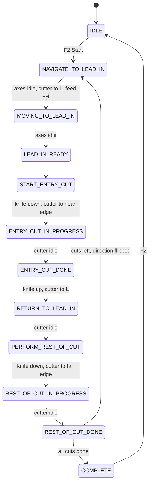
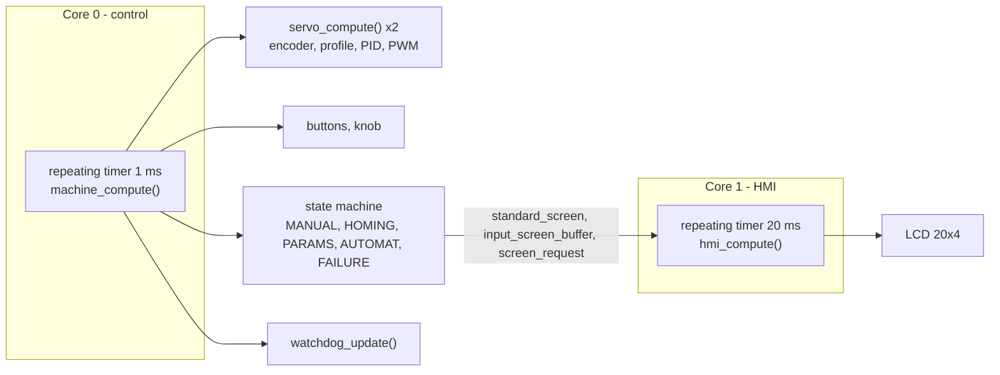
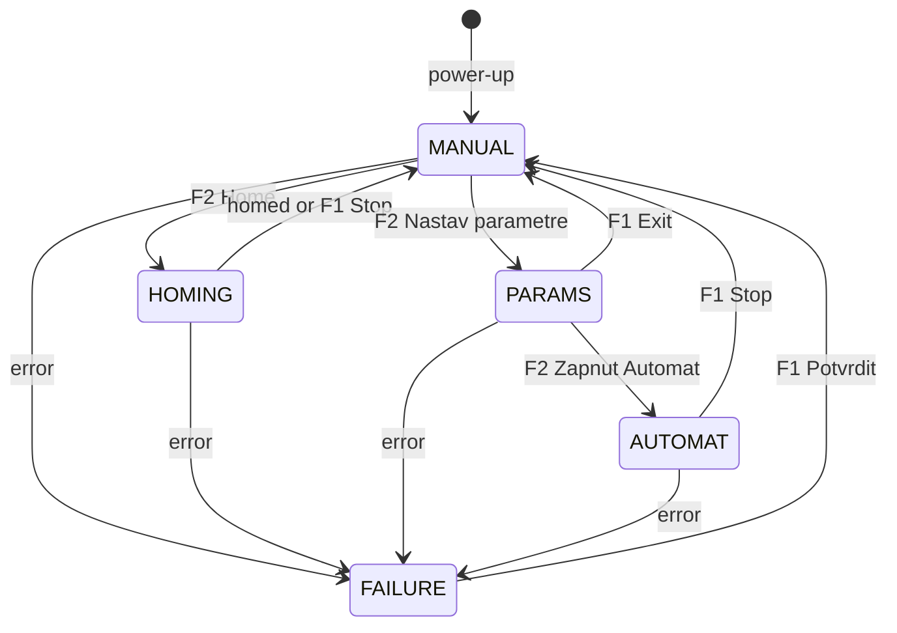

# StickerCutter

StickerCutter turns a non-functional large-format printer/cutter into an automatic **sticker strip cutter**. A roll of printed stickers is cut across its full width into strips – one sticker row per strip – by the knife on the former cutting carriage.

The machine is controlled by a Raspberry Pi Pico (RP2040). The firmware is written in C on the Raspberry Pi Pico SDK and the project is open source on GitHub.

[](https://www.youtube.com/watch?v=yO32YbOaKHE)

## Contents

1. [How it works](#how-it-works)
2. [Hardware](#hardware)
3. [Operating the machine](#operating-the-machine)
4. [Automatic cutting cycle](#automatic-cutting-cycle)
5. [Firmware architecture](#firmware-architecture)
6. [Configuration reference](#configuration-reference)
7. [Building and flashing](#building-and-flashing)
8. [Simulation mode](#simulation-mode)
9. [Repository layout](#repository-layout)
10. [Known limitations and open points](#known-limitations-and-open-points)
11. [Credits and licenses](#credits-and-licenses)

## How it works

The machine has two servo axes and a knife:

| Part | Name in firmware | Function | Drive |
|---|---|---|---|
| X axis | Cutter | moves the carriage with the knife across the paper | DC motor with quadrature encoder, BTS7960 H-bridge |
| Y axis | Feeder | feeds the paper | DC motor with quadrature encoder, BTS7960 H-bridge |
| Knife | `knife_down()` / `knife_up()` | lowers / raises the blade | GPIO 17, MOSFET switch module |

Workflow:

1. **Point the beginning** – jog the paper until the knife is on the line where cutting starts, then zero the feeder.
2. **Enter the job** – sticker height, number of cuts and paper width, set with the rotary knob.
3. **Start** – for every cut the machine feeds the paper by one sticker height and cuts across the whole paper width. Consecutive cuts alternate direction (right to left, left to right, ...), so there is no empty return stroke.

Every cut is made in two strokes: the knife is lowered 10 mm inside the paper edge, cuts outwards over that edge, lifts, returns, and then cuts the rest of the width, leaving over the opposite edge. The blade therefore always starts on the paper and crosses an edge only on its way out.

The original idea of the project – an optical sensor on the head that homes the carriage and finds registration marks printed around the stickers – is prepared in the code but not implemented yet (see [Known limitations](#known-limitations-and-open-points)).

## Hardware

### Components

| Part | Purpose |
|---|---|
| Raspberry Pi Pico (RP2040) | controller |
| 2× BTS7960 43 A H-bridge module | motor drivers for the Cutter and the Feeder |
| 2× DC motor with quadrature encoder | Cutter and Feeder axes; the firmware expects 4000 encoder counts per motor revolution |
| 15 A MOSFET switch module | switches the knife actuator |
| LCD 2004 (HD44780, 20×4 characters) | display |
| Rotary encoder with push switch | value entry |
| 6 push buttons | F1, F2, Left, Right, In, Out |
| 24 V / 10 A power supply, 5 V step-down converter | power |

The full list with prices and shop links (including the emergency stop, ON/OFF button and cut switch) is in [sticker_cutter_BOM.ods](sticker_cutter_BOM.ods).

### Pin map

Taken from the firmware ([machine/machine_controller.c](machine/machine_controller.c), [core1_main.c](core1_main.c)):

| GPIO | Signal | Notes |
|---|---|---|
| 0 | Button **Out** | feeder jog + |
| 1 | Button **Right** | cutter jog + |
| 2 | Button **F2** | right soft key |
| 3 | Button **Left** | cutter jog − |
| 4 | Button **In** | feeder jog − |
| 5 | Button **F1** | left soft key |
| 6, 7 | Cutter encoder A, B | PIO0 SM0, internal pull-ups |
| 8, 9 | Feeder encoder A, B | PIO0 SM1, internal pull-ups |
| 10 | LCD RS | |
| 11 | LCD RW | held low (write only) |
| 12 | LCD E | |
| 13–16 | LCD D4–D7 | 4-bit mode |
| 17 | Knife | high = knife down |
| 18, 19 | Cutter PWM A, B | PWM slice 1; A drives the positive, B the negative direction |
| 20, 21 | Feeder PWM A, B | PWM slice 2; same as above |
| 22 | Home switch | read every cycle, not used by the logic yet |
| 26, 27 | Knob encoder A, B | PIO1 SM0, internal pull-ups |
| 28 | Knob push switch | internal pull-up |

- Buttons are active-high (the switch connects the input to 3.3 V, see the schematic). The firmware does not configure pulls for them, so the RP2040 default pad pull-downs apply.
- Motor and encoder polarity must match: a positive PWM command (channel A) has to make the encoder count up. Otherwise the loop has positive feedback and the axis faults with `Pos Error` or `PID Error`.

### Axes, units and coordinates

- Positions are in millimetres, speeds in mm/s. Internally the servo works in motor revolutions; `SCALE_CUTTER` (20 mm/rev) and `SCALE_FEEDER` (6.4 mm/rev) convert them to millimetres.
- **Cutter (X):** Right is positive, Left is negative. X = 0 is the home position on the right side and the working area lies at negative X. When the machine is homed, cutter jogging is limited to −1500 … +20 mm.
- **Feeder (Y):** Out is positive, In is negative. Automatic feeding goes in the positive (Out) direction. The LCD shows Y relative to the feeder zero that is set during the parameter setup.
- In automatic mode the paper is expected between X = 0 (right edge) and X = −paper width (left edge).

### PCB

The KiCad 6 design is in [pcb/](pcb/):

- [pcb/StickerCutter.kicad_pro](pcb/StickerCutter.kicad_pro) – *Sticker Cutter Mainboard* V1.0 (2023-01-26): Pico, 2× BTS7960, LM2596S step-down, 20×4 LCD, MOSFET module for the knife, six buttons and connectors for 24 V, both encoders, a line sensor and a paper sensor. A 3D model of the board is in [pcb/StickerCutter.step](pcb/StickerCutter.step).
- [pcb/sticer_cutter_main/](pcb/sticer_cutter_main/) – second board project; its schematic is still empty.
- [pcb/HD44780/](pcb/HD44780/) and [pcb/KiCad-RP-Pico-main/](pcb/KiCad-RP-Pico-main/) – third-party symbol and footprint libraries.

## Operating the machine

The user interface texts are in Slovak; translations are in [LCD texts](#lcd-texts).

> **Note:** the parameter setup and automatic mode are only available on a homed machine. With the current firmware that is only the case in the [simulation build](#simulation-mode) – see [Known limitations](#known-limitations-and-open-points).

### Controls

| Control | Function |
|---|---|
| **F1** | left soft key – action shown in the bottom-left corner of the LCD |
| **F2** | right soft key – action shown in the bottom-right corner of the LCD |
| **Left / Right** | jog the cutter: hold to move, release to stop |
| **In / Out** | jog the feeder: hold to move, release to stop |
| **Knob** | change the value on parameter screens; push to change the step size |

### Standard screen

```
+--------------------+
|Manual              |  status / mode
| -120.50mm    0.00mm|  cutter X, feeder Y (from feeder zero)
|Motory        Nastav|  F1 label (left half), F2 label (right half)
|vypnut     parametre|
+--------------------+
```

### Step by step

**1. Power-up.** The welcome screen shows *Sticker Cutter* and the firmware version (output of `git describe`, e.g. `2.0-19-g17b15a2`) for 2 s. The machine starts in **Manual** mode with the motors **enabled**. If the last reset was caused by the watchdog, the fault screen `watchdog reset` is shown – confirm it with F1.

**2. Manual mode** – status `Manual` (`Manual - NO Home` when the machine is not homed).

- F1 `Motory vypnut` / `Motory zapnut` switches the motors off / on.
- Hold Left / Right (cutter) or In / Out (feeder) to jog at 100 mm/s; release to stop. Jogging needs the motors switched on.
- F2 `Nastav parametre` opens the parameter setup (homed machine only). A machine that is not homed offers `Home` instead (see [Homing](#homing)).

**3. Parameter setup.** F1 `Exit` returns to Manual at any step.

| Step | LCD (F2 label) | What to do | Stored in |
|---|---|---|---|
| a. Beginning | `Vynuluj feeder` | Jog the paper (and the cutter) at 20 mm/s until the knife points at the line where cutting starts, then press F2. The feeder display shows `0.00mm`. | `standard_screen.feeder_offset`, `machine.paper_right_mark_position` (cutter X) |
| | `Pokracuj` | Shown while the feeder is exactly at its zero. Press F2 to continue. | |
| b. Sticker height | `Nastav vysku nalepky`, `Uloz vysku` | Turn the knob (1 mm per encoder count). The value starts at the knob's current value – 50.00 after power-up. F2 saves. | `machine.sticker_height` |
| c. Number of cuts | `Nastav pocet rezov`, `Uloz pocet` | Starts at 1, one cut per encoder count. F2 saves. | `machine.rows_to_cut` |
| d. Paper width | `Nastav sirku papiera`, `Uloz sirku` | Starts at 200.00 mm, 2.5 mm per encoder count. F2 saves. | `machine.paper_width` |
| e. Confirm | `Zapnut Automat` | The cutter moves to X = −50 mm and the machine switches to automatic mode. | |

Pushing the knob switches to fine steps (0.025 per encoder count), pushing again to 0.25 per count, and further pushes alternate between the two. Values cannot go below 0.

```
+--------------------+
|Nastav vysku nalepky|
|       50.00        |
|                    |
|Exit      Uloz vysku|
+--------------------+
```

**4. Automatic mode** – status `Automat`.

- F2 `Start` runs the job (see [Automatic cutting cycle](#automatic-cutting-cycle)).
- While cutting, the right half of the LCD shows the number of requested cuts (top) and of finished cuts (bottom).
- F1 `Stop` aborts at any time: both axes ramp down, the knife goes up and the machine returns to Manual. The parameters have to be entered again.
- When the job is finished the LCD shows `Hotovo!` (done). F2 returns to `Start`; another Start cuts the same number of strips again, continuing from the current paper position.

**5. Faults.** The fault screen shows a blinking `* PORUCHA! *` and the reason:

```
+--------------------+
|    * PORUCHA! *    |
|                    |
| Cutter: Pos Error  |
|Potvrdit            |
+--------------------+
```

| Message | Cause |
|---|---|
| `Cutter: Pos Error`, `Feeder: Pos Error` | following error of 1 motor revolution or more (20 mm on the cutter, 6.4 mm on the feeder) |
| `Cutter: PID Error`, `Feeder: PID Error` | a PID integral term reached its limit – the motor cannot follow (blocked, disconnected, no power) |
| `watchdog reset` | the previous reset was caused by the watchdog (control loop stalled for 50 ms) |

On a fault the motors are switched off immediately and the knife is raised. F1 `Potvrdit` (confirm) clears the error and returns to Manual with the motors switched on.

### Homing

Homing is prepared for an optical sensor on the head that tells the cutting table from the empty space ("void") at its right end:

1. Manual mode offers F2 `Home` only when the machine is not homed and the sensor sees the table (`get_void_absence()`).
2. Status `HOMING`, `Hlada sa->` (searching): the cutter moves right at 100 mm/s.
3. When the sensor sees the void (`get_void_presence()`), the cutter ramps down to a stop.
4. The stop position becomes X = 0, then the cutter moves to X = −50 mm.
5. The machine is marked as homed and returns to Manual. F1 `Stop` aborts homing.

Both sensor functions are still stubs that return 0, so homing does not start on real hardware yet.

### LCD texts

| LCD | Meaning |
|---|---|
| `Motory vypnut` / `Motory zapnut` | switch motors off / on |
| `Nastav parametre` | set parameters |
| `Home`, `HOMING`, `Hlada sa->` | start homing, homing, searching |
| `Vynuluj feeder` | zero the feeder (set the beginning) |
| `Pokracuj` | continue |
| `Nastav vysku nalepky`, `Uloz vysku` | set sticker height, save height |
| `Nastav pocet rezov`, `Uloz pocet` | set number of cuts, save count |
| `Nastav sirku papiera`, `Uloz sirku` | set paper width, save width |
| `Zapnut Automat` | switch to automatic mode |
| `Start`, `Stop`, `Exit` | start, stop, leave |
| `Hotovo!` | done |
| `* PORUCHA! *` | fault |
| `Potvrdit` | confirm |

## Automatic cutting cycle

Implemented in [machine/machine_automatic_mode.c](machine/machine_automatic_mode.c). View from above, W = paper width, H = sticker height:

```
         left edge                      right edge
         X = -W                         X = 0
         |                              |
cut 1    |                       L      |  1. move to lead-in L, feed paper by H
         |                       L=====>|  2. knife down: entry cut over the right edge
         |                       L<-----|  3. knife up: back to L
         |<======================L      |  4. knife down: cut through to the left edge
         |                              |
cut 2    |      L                       |  1. move to lead-in L, feed paper by H
         |<=====L                       |  2. knife down: entry cut over the left edge
         |----->L                       |  3. knife up: back to L
         |      L======================>|  4. knife down: cut through to the right edge

         ===> knife down    ---> knife up    L = lead-in point, 10 mm inside the edge
```

Odd cuts start on the right, even cuts on the left:

| Position (cutter X) | Cutting from the right | Cutting from the left |
|---|---|---|
| Lead-in L | −`cut_overlap` (−10 mm) | −W + `cut_overlap` |
| End of the entry cut | 0 | −W |
| End of the rest of the cut | −W | 0 |

- Step 1 moves the cutter to L and, at the same time, feeds the paper by +H relative to its current position. The first cut is therefore made one sticker height after the feeder zero, cut *n* at *n* × H.
- All automatic moves run at 250 mm/s (`AUTOMAT_SPEED_FAST`). Every move starts 0.5 s after it is commanded (`HALF_SECOND_DELAY`), which gives the knife time to go down or up before the carriage moves. The next step waits until the axis has reached its target.
- In the current code the knife is raised only after step 2, at the end of the job, on Stop and on a fault – not after step 4 (see [Known limitations](#known-limitations-and-open-points)).

Sub-states (`automatic_substate_t`):



F1 `Stop` leaves automatic mode from any sub-state. `HOME_RETURN` exists but is not used.

## Firmware architecture

### Runtime overview



Start-up ([sticker_cutter.c](sticker_cutter.c)):

1. `machine_init()` creates the buttons, the knob encoder (PIO1), both servos (PIO0 + PWM) and the knife output, sets the default parameters and enters Manual with the motors enabled. After a watchdog reset it raises the `watchdog reset` error.
2. `stdio_init_all()` – USB CDC stdio (UART stdio is disabled); nothing is printed at the moment.
3. A 1 ms repeating timer on core 0 calls `machine_compute()`. It runs in the timer interrupt.
4. `multicore_launch_core1(core1_main)` – core 1 creates its own alarm pool (hardware alarm 2), starts the 20 ms HMI timer and initialises the LCD ([core1_main.c](core1_main.c)).
5. After 500 ms the watchdog is enabled with a 50 ms timeout (paused while debugging). `machine_compute()` feeds it every cycle.
6. Both cores then idle; all work is timer driven.

Control cycle, `machine_compute()` every 1 ms ([machine/machine_controller.c](machine/machine_controller.c)):

1. `servo_compute()` for the Cutter and the Feeder.
2. `button_compute()` for all buttons, `rotary_encoder_compute()` for the knob.
3. If an error was raised, switch to FAILURE.
4. Copy the axis positions for the display.
5. Run the handler of the current state.
6. `watchdog_update()`.

### Main state machine



| State (`machine_state_t`) | Handler | Source |
|---|---|---|
| `MANUAL` | `handle_manual_state()` – motors on/off, jogging, entry to homing or setup | [machine/machine_manual_mode.c](machine/machine_manual_mode.c) |
| `HOMING` | `handle_homing_state()` – see [Homing](#homing) | [machine/machine_manual_mode.c](machine/machine_manual_mode.c) |
| `PARAMS` | `param_config_state()` – parameter setup wizard | [machine/machine_manual_mode.c](machine/machine_manual_mode.c) |
| `AUTOMAT` | `handle_automatic_state()` – cutting cycle | [machine/machine_automatic_mode.c](machine/machine_automatic_mode.c) |
| `FAILURE` | `handle_failure_state()` – motors off, knife up, waits for F1 | [machine/machine_controller.c](machine/machine_controller.c) |

Every entry to Manual goes through `activate_manual_state()`: both axes ramp down, the knife goes up, the motors are enabled and the paper reference (`machine.paper_right_mark_position`) is cleared.

Global objects:

| Object | Defined in | Contents |
|---|---|---|
| `machine` (`machine_t`) | machine_controller.c | enable, homed, error flag and message, job parameters and progress |
| `devices` (`devices_t`) | machine_controller.c | handles of the servos, buttons and knob |
| `machine_state` | machine_controller.c | current main state |
| `hmi` (`hmi_t`) | core1_main.c | screen state, screen buffers, LCD handle |
| `standard_screen` (`screen_t`) | hmi/hmi.c | status, soft-key labels and positions of the standard screen |

### Servo axis

[servo_motor/servo_motor.c](servo_motor/servo_motor.c) – one `servo_t` per axis, created by `servo_create()` with its encoder state machine, PWM pins, scale, jog buttons and pointers to the shared `machine.enable`, `machine.machine_error` and `machine.error_message`.

`servo_compute()` every 1 ms:

1. Reads the encoder count from the PIO: position [rev] = count / 4000, speed [rev/s] = Δcount per cycle × 1000 / 4000.
2. Applies a pending `servo_set_zero_position()`.
3. Motors disabled: PWM = 0. On the next enable the PIDs and the profile are reset and the set-point is set to the actual position (bumpless start).
4. Following-error check: a deviation of 1 rev or more between position and set-point raises `Pos Error`.
5. The profile generator advances the set-point.
6. Cascaded control: position PID (Kp 40, Ki 0, Kd 0.5) → velocity set-point → velocity PID (Kp 5, Ki 3, Kd 1) → PWM command, ±1024 = ±100 %.
7. A saturated PID integral raises `PID Error`.
8. Position and speed are converted to mm and mm/s.

Profile generator (`next_positon_compute()`), producing a trapezoidal – for short moves triangular – velocity profile with 100 rev/s² (2000 mm/s² on the cutter, 640 mm/s² on the feeder):

| State | Action |
|---|---|
| `IDLE` | hold the set-point |
| `REQUESTED` | choose the direction, count down the start delay (1 ms per cycle) |
| `ACCELERATING` | ramp the speed up to the commanded speed and then cruise; switch to braking when the remaining distance reaches v²/2a |
| `BRAKING` | ramp the speed down to zero |
| `POSITION_REACHED` | snap the set-point to the target (lasts one cycle), then `IDLE` |

API ([servo_motor/servo_motor.h](servo_motor/servo_motor.h)), positions in mm, speeds in mm/s:

| Function | Description |
|---|---|
| `servo_goto(s, pos, speed)` | move to `pos`, start immediately |
| `servo_goto_delayed(s, pos, speed, delay)` | move to `pos`, start after `delay` ms (0 is treated as 500 ms) |
| `servo_stop_positioning(s)` | retarget to the nearest stop point (set-point + braking distance) – controlled stop |
| `servo_manual_handling(s, min, max, speed, homed)` | jog: a button press moves towards `max` / `min`, release stops; limits are ±2000 mm when `homed` is false |
| `servo_set_zero_position(s)` | current position becomes 0 (applied in the next cycle) |
| `servo_set_stop_position(s, pos)` | change the target of a running move |
| `servo_get_position(s)` | position |
| `servo_is_idle()`, `servo_is_accelerating()`, `servo_is_position_reached()`, `servo_is_speed_reached()` | profile state; *accelerating* includes cruising, *position reached* is true for one cycle only |

PWM ([servo_motor/servo_pwm.c](servo_motor/servo_pwm.c)): `pwm_chan_init()` sets up both pins of a slice at 20 kHz (125 MHz / 6.1035 / 1024), 10-bit. `set_two_chans_pwm()` puts a positive command on channel A and a negative one on channel B, matching the RPWM/LPWM inputs of the BTS7960.

PID ([pid/PID.c](pid/PID.c)): `pid_create()` binds pointers to input, output and set-point. `pid_compute()` uses P on the error, an integral accumulated per sample (Ki × error) and D on the measurement. Output and integral are clamped to ±1024; hitting the integral clamp sets the error flag (`pid_get_error()`), which `pid_reset_all()` clears.

### Buttons and knob

[servo_motor/button.c](servo_motor/button.c) – polled every 1 ms:

- `button_raised()` is true for one cycle after a press (rising edge). A press within 1 ms + grace period (200 ms, `button_set_grace_period()`) of the previous accepted press is ignored.
- `button_dropped()` is true for one cycle after a release (1 ms lockout).

[rotary_encoder/rotary_encoder.c](rotary_encoder/rotary_encoder.c) – the knob uses the same PIO quadrature decoder on PIO1 (max. 10 000 steps/s):

- Every cycle the value changes by Δcount / scale and is clamped to 0 … `FLT_MAX`. A negative scale inverts the direction.
- `rotary_encoder_get_position()` rounds to 0.01, `rotary_encoder_get_position_int()` to an integer; `_set_position()`, `_reset_position()` and `_set_scale()` are used by the parameter setup.
- The push switch toggles the scale between −40 and −4 counts per unit (`SCALE_FAST`, `SCALE_SLOW`).

### HMI and LCD

Detailed behaviour, timing and known problems of the display integration: [hmi/README.md](hmi/README.md).

[hmi/hmi.c](hmi/hmi.c) – screens `WELCOME_SCREEN` (2 s after start), `STANDARD_SCREEN`, `INPUT_SCREEN` and `FAILURE_SCREEN`.

Core 0 never accesses the LCD. It communicates with core 1 through shared memory:

- `hmi_set_status()`, `hmi_set_left_button()` and `hmi_set_right_button()` write the status line and the two-line soft-key labels (10 characters each) into `standard_screen`; `machine_compute()` writes the axis positions there as well.
- `show_question()` / `show_question_int()` render a parameter prompt into `hmi.input_screen_buffer`.
- `hmi_request_screen()` posts a screen change in a single `volatile int32_t` (−1 = none). Core 1 performs it in `hmi_compute()` and clears the LCD.
- `get_error_message()` supplies the fault text.

No locks are used, so a frame can occasionally mix old and new text (cosmetic only).

`hmi_compute()` builds the current frame in `actual_screen_buffer` and rewrites all four lines. The layout helpers `place_string_*`, `place_float_*` and `place_int_*` (left, centred, right) pad text into a 20-character line or a 10-character half line; `merge_halfs_lines()` joins two halves.

[lcd/ant_lcd.c](lcd/ant_lcd.c) – HD44780 driver in 4-bit, write-only mode with fixed delays instead of busy-flag polling: `lcd_create()`, `string2LCD()`, `int2LCD()`, `float2LCD()`, `clrscr()`. One character takes about 310 µs, so a full 80-character redraw takes about 26 ms – longer than the 20 ms timer period, i.e. core 1 redraws practically all the time.

### Quadrature decoder

[quadrature_encoder.pio](quadrature_encoder.pio) counts all four edges of the A/B signals in a PIO state machine. The program must be loaded at address 0, so it is loaded once into each PIO block: PIO0 (SM0 cutter, SM1 feeder, full speed) and PIO1 (SM0 knob, 10 000 steps/s). The count is read with `quadrature_encoder_get_count()`.

## Configuration reference

All parameters are compile-time constants.

Machine ([machine/machine_controller.h](machine/machine_controller.h), [machine/machine_controller.c](machine/machine_controller.c)):

| Name | Value | Meaning |
|---|---|---|
| `SCALE_CUTTER` | 20.0 | cutter travel per motor revolution [mm] |
| `SCALE_FEEDER` | 6.4 | feeder travel per motor revolution [mm] |
| `KNIFE_OUTPUT_PIN` | 17 | knife output |
| `ENC_0`, `ENC_1` | 6, 8 | cutter / feeder encoder phase A (phase B is the next GPIO) |
| `PWM_0`, `PWM_1` | 18, 20 | cutter / feeder PWM channel A (channel B is the next GPIO) |
| `machine.cut_overlap` | 10.0 | lead-in distance from the paper edge [mm] |
| `machine.paper_width` | 200.0 | default paper width [mm] |
| knob start value | 50.0 | first sticker height offered after power-up [mm] |
| `MANUAL_SPEED_SLOW` | 20 | jog speed during the parameter setup [mm/s] |
| `MANUAL_SPEED_NORMAL` | 100 | jog speed in Manual [mm/s] |
| `MANUAL_SPEED_FAST` | 200 | move to X = −50 mm when entering Automat [mm/s] |
| `AUTOMAT_SPEED_FAST` | 250 | all automatic moves [mm/s] |
| `HALF_SECOND_DELAY` | 500 | start delay of automatic and homing moves [ms] |
| jog limits | −1500 … +20 | cutter jog range when homed [mm]; ±2000 mm otherwise and for the feeder (`servo_manual_movement()`) |
| `AUTOMAT_SPEED_SCAN`, `_SLOW`, `_MID`, `_NORMAL`, `_CUT` | 15, 50, 100, 200, 180 | not used yet [mm/s] |
| `SENSOR_KNIFE_OFFSET_X`, `_Y` | 25, 14 | offset between the planned optical sensor and the knife [mm] |
| `FAR_AWAY_DISTANCE`, `POSITION_EDGE_RIGHT`, `POSITION_EDGE_LEFT` | 1000, −45, −1480 | not used yet |
| `DESK_AREA_RIGHT`, `DESK_AREA_LEFT` ([machine_manual_mode.c](machine/machine_manual_mode.c)) | −200, −1300 | not used yet |
| `STICKER_HEIGHT_TOLERNACE` ([machine_automatic_mode.c](machine/machine_automatic_mode.c)) | 10 | not used yet |

Motion control ([servo_motor/servo_motor.c](servo_motor/servo_motor.c), [pid/PID.c](pid/PID.c), [servo_motor/servo_pwm.c](servo_motor/servo_pwm.c)):

| Name | Value | Meaning |
|---|---|---|
| `CYCLE_TIME` | 0.001 s | control period |
| encoder resolution | 4000 counts/rev | in `servo_compute()` and `enc2speed()` |
| `FOLLOWING_ERROR` | 1.0 rev | maximum deviation from the set-point |
| `nominal_acc` | 100 rev/s² | acceleration and deceleration |
| position PID | Kp 40, Ki 0, Kd 0.5 | output: velocity set-point [rev/s] |
| velocity PID | Kp 5, Ki 3, Kd 1 | output: PWM command |
| `PID_OUT_MIN/MAX`, `PID_ITERM_MIN/MAX` | ±1024 | output and integral limits |
| `CLK_DIV_20KHZ`, wrap | 6.1035, 1023 | 20 kHz, 10-bit PWM |

Inputs, HMI and system:

| Name | Value | Meaning |
|---|---|---|
| `BUTTON_DEBOUNCE_TIME` ([button.c](servo_motor/button.c)) | 1000 µs | edge lockout |
| `grace_period` ([button.c](servo_motor/button.c)) | 200 ms | minimum time between two accepted presses |
| `SCALE_FAST`, `SCALE_SLOW` ([rotary_encoder.c](rotary_encoder/rotary_encoder.c)) | −40, −4 | knob counts per unit, toggled by the push switch |
| `DISPLAY_COLS`, `DISPLAY_ROWS`, `LCD_PIN_*` ([core1_main.c](core1_main.c)) | 20 × 4, GPIO 10–16 | LCD |
| HMI timer ([core1_main.c](core1_main.c)) | 20 ms | LCD refresh period |
| `WELCOME_INTERVAL_US` ([hmi.c](hmi/hmi.c)) | 2 s | welcome screen duration |
| `BLINK_INTERVAL_US` ([hmi.c](hmi/hmi.c)) | 0.5 s | blink period of the fault header |
| `WATCHDOG_TIMEOUT_MS` ([sticker_cutter.c](sticker_cutter.c)) | 50 ms | watchdog timeout |

## Building and flashing

Requirements: Raspberry Pi Pico SDK 2.2.0, Arm GNU Toolchain 14.2.Rel1 and picotool 2.2.0-a4 (pinned in [CMakeLists.txt](CMakeLists.txt) for the Raspberry Pi Pico VS Code extension), CMake 3.13 or newer and git. Target board: `pico`.

**VS Code:** open the folder with the *Raspberry Pi Pico* extension installed. It downloads the pinned SDK and toolchain into `~/.pico-sdk`; build and flash with the extension's compile and run commands.

**Command line:**

```bash
export PICO_SDK_PATH=/path/to/pico-sdk              # not needed with the VS Code extension
cmake -S . -B build -DENABLE_SIMULATION_MODE=OFF    # OFF = real machine, ON (default) = simulation
cmake --build build
```

The result is `build/stickerCutter.uf2` (plus `.elf`, `.bin` and `.hex`). Flash it by holding BOOTSEL while plugging in the USB cable and copying the UF2 file to the `RPI-RP2` drive, or with `picotool load -x build/stickerCutter.uf2 -f`.

Build notes:

- `ENABLE_SIMULATION_MODE` defaults to **ON**. CMake caches option values, so pass `-D` explicitly when switching (or delete the build directory).
- The firmware version shown on the welcome screen is the output of `git describe --tags --always`, taken at configure time. Re-run the CMake configure step to refresh it.
- USB stdio is enabled, UART stdio is disabled.

## Simulation mode

### Python desktop simulator (no hardware)

Create a virtual environment and run the standalone top-view animation with
Python 3.9 or newer:

```bash
python3 -m venv .venv
.venv/bin/python simulator.py
```

On Windows, run `.venv\Scripts\python.exe simulator.py` instead. The simulator
uses Tkinter from the base Python installation, with no pip dependencies. On
Debian/Ubuntu, if Tkinter is missing, install it with
`sudo apt install python3-tk`. A graphical desktop is required.

- Enter paper width, sticker height and number of cuts, then click **Start job**.
- Watch both axes move simultaneously to feed a row and position the cutter.
  Each row uses the 10 mm lead-in, outward entry cut, knife-up return, and
  full-width cut; successive rows alternate direction.
- Red lines show actual cuts attached to the moving paper. The carriage blade
  is red when down and green when up. Dashed lines are row guides.
- Hold **Left / Right / In / Out** to jog when idle. **Zero feeder** sets the
  paper reference without removing previous cuts.
- **Stop / knife up** aborts immediately and keeps partial cuts visible.
  **Reset simulation** clears motion and cut history. Starting again continues
  from the current paper position; animation speed is adjustable.

This is a functional model, not a firmware emulator: motion is linear at
250 mm/s with the documented 0.5 s command delay, without acceleration,
PID, encoders, sensors, faults, or the LCD parameter wizard. It never connects
to hardware. Unlike the current firmware issue noted below, it **raises the
knife before feeding the next row**. It rejects non-positive heights/counts
and widths outside 20–1500 mm (two 10 mm lead-ins and the cutter travel limit).
Job settings are locked while running.

The motion model can also be tested without Tkinter or a display:

```bash
.venv/bin/python -m unittest discover -s tests -v
```

### Pico firmware simulation

With `ENABLE_SIMULATION_MODE=ON` the build defines `SIMULATION_MODE`, which:

- ignores the encoders – the measured position equals the profile set-point and the speed equals the profile speed,
- skips the PID controllers and the PWM output – **the motors are never driven**,
- cannot raise `Pos Error` or `PID Error`,
- starts as homed, so the parameter setup and Automat are available without a home sensor,
- **still switches the knife output** (GPIO 17).

This allows testing the complete user interface and cutting sequence on a Pico with the LCD, buttons and knob only.

## Repository layout

```
StickerCutter/
├── CMakeLists.txt                       build script, ENABLE_SIMULATION_MODE option
├── pico_sdk_import.cmake                Pico SDK locator
├── sticker_cutter.c                     main(): init, 1 ms control timer, core 1 start, watchdog
├── core1_main.c/.h                      core 1: LCD configuration, 20 ms HMI timer, global hmi
├── quadrature_encoder.pio               PIO quadrature decoder
├── machine/
│   ├── machine_controller.c/.h          devices, pin map, control cycle, FAILURE state, knife, errors
│   ├── machine_manual_mode.c/.h         MANUAL, HOMING and PARAMS states, jogging
│   └── machine_automatic_mode.c/.h      AUTOMAT state (cutting cycle), mark sensor placeholders
├── servo_motor/
│   ├── servo_motor.c/.h                 DC servo axis: profile generator, cascaded PID, jogging
│   ├── servo_pwm.c/.h                   20 kHz two-channel PWM for the BTS7960
│   └── button.c/.h                      button edge detection with debounce and grace period
├── pid/PID.c/.h                         PID controller
├── rotary_encoder/rotary_encoder.c/.h   knob
├── hmi/hmi.c/.h                         screens, text layout, rendering
├── lcd/ant_lcd.c/.h                     HD44780 driver
├── pcb/                                 KiCad projects and libraries
├── sticker_cutter_BOM.ods               bill of materials
└── yt_video.png                         video thumbnail
```

## Known limitations and open points

Functional state:

- **Simulation is the default build.** `ENABLE_SIMULATION_MODE` defaults to `ON`, and the motors are not driven in that build.
- **No sensors yet.** `get_void_absence()` / `get_void_presence()` (homing) and `get_mark_position()` (registration marks) are stubs returning 0; `stop_knife_on_mark()`, `stop_knife_between_marks()` and `reset_paper_mark_positions()` are not called. The home switch (GPIO 22) is read but not used, and the board's *Line Sensor* and *Paper Sensor* inputs are not read.
- **A hardware build cannot reach the parameter setup or Automat.** Without homing `machine.homed` stays `false`; Manual then offers F2 only for homing, and the `Home` key never appears because `get_void_absence()` returns 0.
- **The paper's X position is fixed.** Cut positions are absolute: right paper edge at X = 0, left edge at X = −width. The cutter X stored by `Vynuluj feeder` only serves as a "parameters set" flag.
- **Parameters are not kept.** Every return to Manual clears the paper reference, so the setup must be repeated after Stop or a fault. For the same reason the `Automat` key in Manual never appears.
- **No plausibility checks in Automat.** The paper width is not checked against the cutter travel, and a cut count of 0 still performs one cut.

Known issues in the current code:

- The knife is not raised after the rest-of-cut stroke (`REST_OF_CUT_DONE`). It stays down while the paper is fed and the cutter moves to the next lead-in point.
- F1 `Exit` on the input screens (sticker height, cuts, width) returns to Manual without requesting `STANDARD_SCREEN`, so the LCD keeps showing the input screen.
- Homing (not reachable yet): `activate_homing_state()` resets `manual_substate` instead of `homing_substate`, and `servo_set_zero_position()` takes the new offset from the already offset position, so only the first zeroing after power-up is correct.
- `close_question()` is declared in [hmi/hmi.h](hmi/hmi.h) but not implemented; `input_screen` and `struct input_screen` are not used.

## Credits and licenses

- [quadrature_encoder.pio](quadrature_encoder.pio) – © 2021 pmarques-dev, BSD-3-Clause (as published in the Raspberry Pi pico-examples).
- [pcb/KiCad-RP-Pico-main/](pcb/KiCad-RP-Pico-main/) – TPCWare KiCad library, CC BY-SA 4.0 with a design exception (see its LICENSE).
- [pcb/HD44780/](pcb/HD44780/) – SnapEDA symbol and footprint, SnapEDA license (see License.txt).
- The repository has no top-level license file yet.
