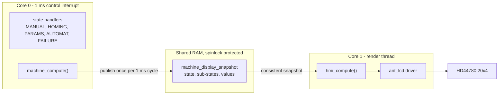
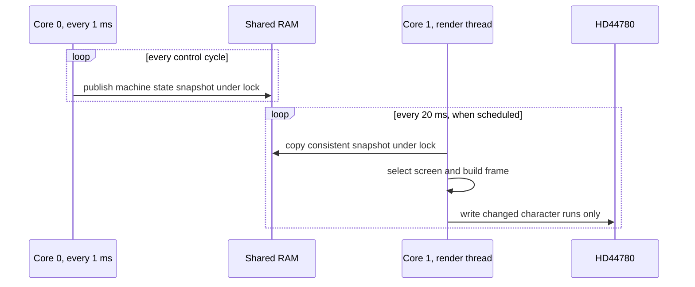
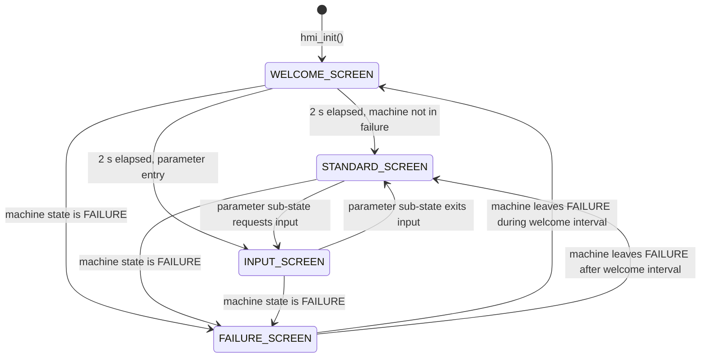

# HMI and LCD integration

How the 20×4 character LCD is integrated into the firmware: how core 0 publishes machine state, how core 1 selects and renders screens, LCD timing and remaining limitations. For the operator's view of the screens see the [main README](../README.md#operating-the-machine).

| File | Role |
|---|---|
| [core1_main.c](../core1_main.c) | core 1 entry point, LCD pins and size, refresh timer, defines the global `hmi` |
| [hmi.c](hmi.c), [hmi.h](hmi.h) | screen model, text layout helpers, screen switching, frame rendering |
| [ant_lcd.c](../lcd/ant_lcd.c), [ant_lcd.h](../lcd/ant_lcd.h) | HD44780 driver, 4-bit, write only |
| [machine_controller.c](../machine/machine_controller.c) | publishes a locked display snapshot and owns machine error state |
| [machine_manual_mode.c](../machine/machine_manual_mode.c) | Manual, Homing and parameter state machines |
| [machine_automatic_mode.c](../machine/machine_automatic_mode.c) | automatic state machine |

## Overview



- Core 0 never touches the LCD or formats HMI text. It publishes a compact machine-state snapshot under a spin lock after each control cycle.
- Core 1 owns the LCD and decides the screen from that snapshot. It compares each frame with a shadow copy and sends only changed character runs.
- The 20 ms timer only schedules work. Rendering and LCD delays run in core 1 thread mode.

## Execution model and timing

Core 1 ([core1_main.c](../core1_main.c)) runs:

1. `hmi_init(&hmi, &lcd_cfg)` initializes the LCD before starting the refresh timer.
2. `alarm_pool_create(2, 4)` creates its own alarm pool on hardware alarm 2, owned by core 1.
3. `alarm_pool_add_repeating_timer_ms(pool, -20, ...)` sets a flag every 20 ms; the callback does no LCD work.
4. The core 1 main loop calls `hmi_compute(&hmi)` when scheduled and publishes a heartbeat after rendering.

LCD delays run in thread mode and do not hold the timer interrupt open.

Durations derived from the driver's fixed delays (GPIO overhead neglected):

| Operation | Duration |
|---|---|
| nibble: E high 1 µs, E low 1 µs | ≈2 µs |
| byte (command or character): 2 nibbles + 50 µs | ≈54 µs |
| full 80-character frame, including 4 row addresses | ≈4.5 ms |
| steady-state frame with no changes | no LCD transactions |
| `clrscr()` | 2 ms after the command |
| cold `lcd_create()` initialisation | ≈48 ms |
| re-initialisation plus full-frame redraw on screen change | ≈12 ms |

Consequences:

- A complete changed frame fits within one 20 ms refresh interval; unchanged frames do not access the LCD.
- A change is normally visible at the next refresh (up to 20 ms plus rendering time).
- Text is formatted on core 1 only when rendering; core 0 publishes raw state and values.



## Data structures and ownership

`hmi_t hmi` – defined in [core1_main.c](../core1_main.c), declared `extern` in [core1_main.h](../core1_main.h):

| Field | Meaning |
|---|---|
| `screen_state` | screen currently shown, derived from the machine snapshot |
| `start_us` | time of `hmi_init()`; used for the welcome duration and the blink phase |
| `welcome_screen_buffer` | built once in `hmi_init()` |
| `actual_screen_buffer` | the frame built for this refresh |
| `displayed_screen_buffer` | shadow copy used to skip unchanged characters |
| `lcd` | driver handle |

`machine_display_snapshot_t` is copied under a Pico spin lock. It contains the machine and sub-state enums, relevant flags, positions, parameter values, encoder value, counters and a bounded error-message copy. Core 1 reads one consistent snapshot per render and formats all screen text locally; no display buffers or formatted strings are shared.

## Screens

### Screen state machine



- `screen_state` is selected by core 1 from the snapshot on every render; there is no request slot to lose or stale screen to leave behind.
- On a screen change the driver re-synchronizes its 4-bit interface and clears the LCD. The shadow buffer is reset so the next draw writes the complete frame.

### Screen shown in each machine state

| Machine state | Screen | Displayed content |
|---|---|---|
| first 2 s after start, unless `FAILURE` | WELCOME | title and firmware version |
| `MANUAL` | STANDARD | `Manual` / `Manual - NO Home`, motor labels and context-dependent F2 |
| `HOMING` | STANDARD | `HOMING`, F1 `Stop`, F2 `Hlada sa->` while scanning |
| `PARAMS`, `PARAM_START` | STANDARD | F2 `Vynuluj feeder` or `Pokracuj`; F1 `Exit` |
| `PARAMS`, `PARAM_STICKER_HEIGHT`, `PARAM_ROWS_TO_CUT`, `PARAM_PAPER_WIDTH` | INPUT | prompt, snapshot encoder value and parameter labels |
| `PARAMS`, `PARAM_FINSIHED` | STANDARD | F2 `Zapnut Automat`; F1 `Exit` |
| `AUTOMAT` | STANDARD | `Automat`; F1 `Stop`; F2 `Start`, cut counters or `Hotovo!` |
| `FAILURE` | FAILURE | snapshot copy of `machine.error_message` |
| `MANUAL` after F1 `Exit` in an input step | STANDARD | screen follows machine state on the next refresh |

### Layouts

STANDARD, built by core 1 from the machine snapshot:

| Row | Columns 0–9 | Columns 10–19 |
|---|---|---|
| 0 | state-specific status, left-aligned over the whole row | |
| 1 | `pos_cutter` as `%.2fmm`, right-aligned | `pos_feeder − feeder_offset` as `%.2fmm`, right-aligned |
| 2 | state-specific top F1 label | state-specific top F2 label |
| 3 | state-specific bottom F1 label | state-specific bottom F2 label |

```
+--------------------+
|Manual              |
| -120.50mm    0.00mm|
|Motory        Nastav|
|vypnut     parametre|
+--------------------+
```

INPUT, built by core 1 from the parameter sub-state and the encoder values in the snapshot:

| Row | Columns 0–9 | Columns 10–19 |
|---|---|---|
| 0 | question, left-aligned over the whole row | |
| 1 | value centred over the whole row: `%.2f` or `%d` | |
| 2 | left and right top labels |
| 3 | left and right bottom labels |

```
+--------------------+
|Nastav vysku nalepky|
|       50.00        |
|                    |
|Exit      Uloz vysku|
+--------------------+
```

FAILURE, built by core 1:

| Row | Content |
|---|---|
| 0 | `* PORUCHA! *` centred; blank in every other 0.5 s period, phase counted from `hmi_init()` |
| 1 | empty |
| 2 | copied error message, centred |
| 3 | `Potvrdit`, left-aligned |

WELCOME, built once in `hmi_init()`: row 1 `Sticker Cutter` centred, row 3 `GIT_VERSION` right-aligned, rows 0 and 2 empty.

## Text layout

All helpers write exactly n − 1 characters plus NUL, where n is `LINE_LENGTH_FULL` (21) or `LINE_LENGTH_HALF` (11):

| Helper | Result |
|---|---|
| `place_string_to_left(line, s, n)` | `s` padded with spaces on the right; longer text is cut |
| `place_string_to_right(line, s, n)` | `s` padded with spaces on the left; longer text is cut at its end |
| `place_string_centered(line, s, n)` | `s` centred, an odd extra space goes to the right; text of n − 1 or more characters is cut |
| `place_float_*`, `place_int_*` | the same alignments for `%.*f` / `%d` |
| `place_float_with_unit_to_right(line, v, d, unit, n)` | `v` with `d` decimals followed by `unit`, right-aligned; when too long, the end (the unit) is cut |
| `merge_halfs_lines(line, a, b)` | `a` and `b` as two halves of exactly 10 characters (`%-10.10s%-10.10s`) |
| `clear_line()`, `clear_screen()` | rows of 20 spaces |

Limits that follow from this:

- Status and question rows hold 20 characters. `Nastav vysku nalepky:` and `Nastav sirku papiera:` have 21, so the colon is cut off.
- Each soft-key label row holds 10 characters; `Hlada sa->` and `Uloz vysku` use all of them.
- Positions from `-9999.99mm` to `99999.99mm` fit into a half row; longer values lose characters from the end, the unit first.
- Parameter units are not currently displayed.
- `machine.error_message` holds 20 characters plus NUL; `raise_error()` does not check the length.
- Texts are plain ASCII without Slovak diacritics: the HD44780 character ROM has no letters such as č, š or ž, and no custom characters are defined.

## Frame rendering

`hmi_compute()` copies the latest machine snapshot under the spin lock, derives the screen from machine and parameter sub-states, and builds the complete desired frame on core 1. It compares the frame with `displayed_screen_buffer` and sends only contiguous runs of changed characters. A stable display therefore causes no LCD transactions. A screen transition reinitializes and clears the LCD, then invalidates the shadow so the next draw sends a complete frame.

## LCD driver

[ant_lcd.c](../lcd/ant_lcd.c) drives an HD44780-compatible controller in 4-bit mode: RS = GPIO 10, RW = GPIO 11 (held low), E = GPIO 12, D4–D7 = GPIO 13–16. The busy flag is never read; the driver relies on fixed delays. If the module runs on 5 V, reading it would put 5 V on the RP2040 pins, which are not 5 V tolerant.

| Function | Behaviour |
|---|---|
| `lcd_create(cfg)` | allocates the driver state, sets the 7 pins as outputs, waits 40 ms for power-up, then runs the datasheet 4-bit initialization sequence |
| `string2LCD(lcd, x, y, s)` | sets the DDRAM address and writes `s` up to its NUL |
| `clrscr(lcd)` | clear display (0x01), then waits 2 ms |
| `int2LCD()`, `float2LCD()` | format with `asprintf()` (heap) and write; not used by the HMI |
| `gotoxy()` | DDRAM address = x + 0x00 / 0x40 / 0x14 / 0x54 for rows 0–3; a row outside the display maps to row 0 |
| `command()`, `write_data()` | one byte as two nibbles with RS = 0 / RS = 1, then 50 µs |
| `command4bit()`, `e_blink()` | puts a nibble on D4–D7 and pulses E: 1 µs high, 1 µs low |

Initialisation in `lcd_create()` and `lcd_reinitialize()`:

| Step | Sent | Time until the next nibble is latched |
|---|---|---|
| 1 | – | 40 ms at power-on |
| 2 | wake-up nibble 0x3 | 5 ms |
| 3 | wake-up nibble 0x3 | 150 µs |
| 4 | wake-up nibble 0x3 | 150 µs |
| 5 | nibble 0x2: switch to 4-bit mode | 150 µs |
| 6 | 0x28: 4-bit, 2 lines, 5×8 font | 50 µs |
| 7 | 0x0C: display on, cursor and blink off | 50 µs |
| 8 | 0x01: clear | 2 ms |
| 9 | 0x06: entry mode, increment, no shift | – |

Compared with the HD44780 datasheet (oscillator 270 kHz):

| Requirement | Datasheet | Driver |
|---|---|---|
| power-on to first command | > 15 ms after VCC reaches 4.5 V (> 40 ms after 2.7 V) | 40 ms |
| after the first wake-up nibble | > 4.1 ms | 5 ms |
| after the second wake-up nibble | > 100 µs | 150 µs |
| ordinary command or character | 37 µs | 50 µs |
| clear display | 1.52 ms | 2 ms; reinitialization is also performed on screen changes |

## Start-up sequence

| Time | Core 0 | Core 1 |
|---|---|---|
| 0 | `machine_init()`: Manual, motors on, snapshot lock initialized; `stdio_init_all()` | waits in the boot ROM |
| T | 1 ms control timer started, `multicore_launch_core1()` | `hmi_init()` and LCD initialization |
| T + 1 ms | first `machine_compute()`: publishes the initial state snapshot | LCD power-on sequence in progress (≈48 ms) |
| after LCD init | | alarm pool and 20 ms scheduling timer start; core 1 renders WELCOME and updates its heartbeat |
| T + 500 ms | watchdog enabled | |
| ≈ T + 2 s | | WELCOME → state-derived screen |

## Rules for code on core 0

These rules describe the current ownership boundary:

- Machine state handlers do not call HMI APIs or write display buffers.
- `machine_compute()` publishes the display snapshot once per cycle; its lock protects snapshot copies between cores.
- Core 1 alone chooses the screen, formats text and calls LCD driver functions.
- Respect the widths listed in [Text layout](#text-layout) and use ASCII only.

## Remaining limitations

- The knob step size is not shown when the operator changes it.
- Two parameter prompts are truncated by the 20-character line limit, and the `units` arguments are not rendered.
- F1, F2 and jogging remain active during the 2-second welcome screen.
- The LCD interface is reinitialized on screen changes, but a display glitch that occurs while the same screen remains active is not automatically detected.
- The HMI consumes `machine_display_snapshot_t` from the machine-controller interface; that is the remaining compile-time coupling between the UI and machine model.
- The LCD driver's unused `int2LCD()` / `float2LCD()` helpers still allocate with `asprintf()`.

## Rework status

The listed rework directions are implemented:

- Core 0 publishes a spinlock-protected state/value snapshot once per control cycle; core 1 derives the screen and text, replacing direct HMI buffer writes and screen requests.
- A shadow frame suppresses unchanged LCD writes.
- LCD command timing and the power-on sequence follow the required minimum delays; clear waits 2 ms.
- The LCD is reinitialized on each screen transition.
- The timer callback only schedules work; core 1 renders in thread mode.
- Core 1 publishes a heartbeat after rendering, and core 0 only feeds the watchdog after observing progress.
