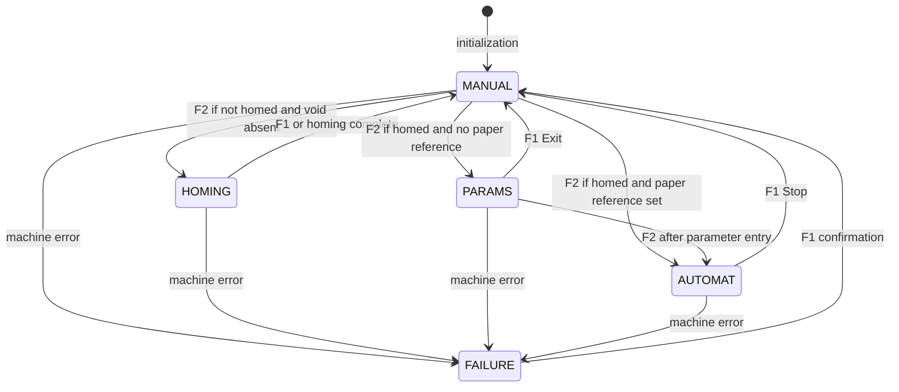

# Machine controller

This document describes the current contents of `machine/`, including uncommitted changes present during the review. The findings are based on source inspection, not tests on the machine. Motor and knife behavior must be validated on hardware with appropriate safeguards.

## Files and responsibilities

| File | Responsibility |
|---|---|
| [machine_controller.h](machine_controller.h) | Machine and sub-state enums, configuration constants, shared device/machine structures, display snapshot and controller API. |
| [machine_controller.c](machine_controller.c) | Device initialization, 1 ms control cycle, fault handling, knife output, display snapshot and watchdog feeding. |
| [machine_manual_mode.h](machine_manual_mode.h) | Manual, homing, parameter setup and jogging function declarations. |
| [machine_manual_mode.c](machine_manual_mode.c) | Manual jogging and motor enable, homing sequence and parameter entry state machines. |
| [machine_automatic_mode.h](machine_automatic_mode.h) | Automatic-mode and paper-reference function declarations. |
| [machine_automatic_mode.c](machine_automatic_mode.c) | Automatic feed/cut sequence, cut direction and placeholder mark-sensor functions. |

Related implementations: [servo motor](../servo_motor/servo_motor.c), [buttons](../servo_motor/button.c), [rotary encoder](../rotary_encoder/rotary_encoder.c), [HMI](../hmi/hmi.c) and [program entry point](../sticker_cutter.c).

## Initialization and control cycle

`machine_init()` claims a display-snapshot spin lock, creates six operator buttons and the home-switch input, initializes the knob and both servos, configures the knife output, sets defaults and enters Manual. A watchdog-caused reboot sets the machine error to `watchdog reset`. On the first control cycle that error causes entry to Failure.

| Device | GPIO / resource | Notes |
|---|---|---|
| F1, F2, Left, Right, In, Out | 5, 2, 3, 1, 4, 0 | `button_raised()` and `button_dropped()` supply edge events. |
| Home switch | 22 | Sampled every cycle but not used in the homing decision. |
| Knob encoder, switch | 26–27, 28 | PIO1 state machine 0; initial value 50. |
| Cutter encoder, motor | 6–7, 18–19 | PIO0 state machine 0; 20 mm per motor revolution. |
| Feeder encoder, motor | 8–9, 20–21 | PIO0 state machine 1; 6.4 mm per motor revolution. |
| Knife | 17 | High lowers; low raises. |

The control timer in [sticker_cutter.c](../sticker_cutter.c#L21) calls `machine_compute()` every 1 ms. Each cycle, in order:

1. Updates both servos, then buttons, home-switch input and knob.
2. Enters `FAILURE` if `machine.machine_error` is set and the machine is not already in Failure.
3. Runs the current machine-state handler.
4. Publishes a snapshot of state, positions, encoder values, counters and the error message for core 1.
5. Feeds the watchdog only if the core 1 render heartbeat has advanced since the last feed.

The watchdog is enabled with a 50 ms timeout after the initial 500 ms startup wait. Core 1 updates its heartbeat after a scheduled HMI render; it does not prove that the LCD is physically working. A Pico SDK spin lock protects the snapshot copy.

`SIMULATION_MODE` is enabled by default by [CMakeLists.txt](../CMakeLists.txt#L65): the machine starts marked as homed and the servo code simulates position rather than driving motors. The knife GPIO is still driven. Simulation is not a safety interlock.

## State and data model

The homing transition is currently unreachable through normal Manual operation because `get_void_absence()` is a stub returning zero. In a non-simulation build the machine starts unhomed, so parameter setup and automatic mode are also unavailable through this UI path.

`devices` holds the servo, button and encoder handles. `machine` holds enable/homed/error flags, error text, feeder display offset, paper reference, job parameters and cut count. The sub-state globals select the current step within Manual, Homing, Params and Automat. `machine_display_snapshot_t` is the HMI-facing copy; the HMI selects and formats screens on core 1 rather than having state handlers write LCD buffers.

## Manual and homing

- **Entering Manual:** clears `paper_right_mark_position`, sets `MANUAL_READY`, requests a controlled stop of both servo profiles, enables motors and raises the knife.
- **Manual F1:** toggles `MANUAL_READY` / `MANUAL_IDLE` and motor enable. In Ready, the four directional buttons jog: cutter at 100 mm/s, limited to −1500…20 mm if homed; feeder at 100 mm/s using the servo's unhomed limits (−2000…2000 mm).
- **Manual F2:** when homed, chooses automatic mode if a paper reference is nonzero, otherwise parameter setup. When unhomed, homing requires `get_void_absence()` to be true.
- **Homing as written:** start a delayed cutter move to 2000 mm, wait for `get_void_presence()`, stop, wait for the profile to reach its target, set the current position to zero, move to −50 mm, mark the machine homed and enter Manual. F1 requests a return to Manual. The sensor functions and transition defects in M2–M3 prevent this from being a complete, reliable homing implementation.

Jogging sends a position command on a button press and calls `servo_stop_positioning()` on a button release; it is not a direct level-controlled motor command. The speed and limits passed by the machine code are in mm/s and mm respectively.

## Parameter setup

F1 exits to Manual. F2 advances through:

| Sub-state | Behavior |
|---|---|
| `PARAM_START` | Slow jog at 20 mm/s. If feeder position differs from `feeder_offset` by at least 0.01 mm, F2 stores the current feeder position as its display zero and stores the current cutter position as `paper_right_mark_position`; otherwise F2 immediately advances to height entry. |
| `PARAM_STICKER_HEIGHT` | F2 saves the knob value as sticker height, sets the knob to 1 and selects rows. |
| `PARAM_ROWS_TO_CUT` | F2 saves the rounded integer as `rows_to_cut`, sets the knob to 200 and selects paper width. |
| `PARAM_PAPER_WIDTH` | F2 saves the knob value as `paper_width` and advances to `PARAM_FINSIHED`. |
| `PARAM_FINSIHED` | F2 commands the cutter to −50 mm at 200 mm/s and enters Automat. |

The knob input has a lower limit of zero but no practical machine-specific upper limit. Button presses can change its scale; the step configured by the parameter state may therefore change while editing. Parameters are not validated before saving or running.

## Automatic cycle

`activate_automatic_state()` resets the direction to start from the right and resets the performed-cut count. In `IDLE`, F2 starts a job; F1 in any automatic sub-state enters Manual. Except for the initial −50 mm move from the finished-parameters step, the programmed automatic moves use 250 mm/s and a 500 ms start delay.

| Step | Action / transition |
|---|---|
| `NAVIGATE_TO_LEAD_IN` | Once both axes report idle, move cutter to `-cut_overlap` from the right or `-paper_width + cut_overlap` from the left, while moving feeder by `sticker_height`. |
| `MOVING_TO_LEAD_IN`, `LEAD_IN_READY` | Wait for both servo profiles to be idle, then advance. |
| `START_ENTRY_CUT`, `ENTRY_CUT_IN_PROGRESS` | Lower knife, command cutter to the near edge (`0` or `-paper_width`), wait for cutter profile idle. |
| `ENTRY_CUT_DONE`, `RETURN_TO_LEAD_IN` | Raise knife, return to the lead-in point, wait for cutter profile idle. |
| `PERFORM_REST_OF_CUT`, `REST_OF_CUT_IN_PROGRESS` | Lower knife, move to the opposite edge (`-paper_width` or `0`), wait for cutter profile idle. |
| `REST_OF_CUT_DONE` | Increment count, alternate direction and either start another feed/cut or advance to Complete. |
| `COMPLETE` | Raise knife; F2 returns to Idle. |

The default `cut_overlap` is 10 mm. Positions in this cycle are absolute cutter coordinates, while the feeder target is its current position plus sticker height. `HOME_RETURN` merely sets Idle and is not reached by the current sequence; `ENTRY_CUT_RETURN` is declared but has no handler.

## Faults and operator recovery

Both servos share pointers to `machine.enable`, `machine.machine_error` and the error-message array. A servo can set the error during its update; `machine_compute()` then enters Failure, sets `enable` false and raises the knife. F1 in Failure calls `activate_manual_state()`, clears the message and clears the error flag. This is a software-controlled recovery, not an independently monitored emergency stop. The ordering and same-cycle confirmation caveats are described in M8.

## Issues found

Severity is relative to this firmware review: **critical** can cause unintended motion or cutting; **high** blocks normal operation or permits unsafe/invalid operation; **medium** affects correctness or robustness. Several defects are latent until the disabled homing/sensor paths or a real-hardware build are used.

### M1 — Snapshot lock API mismatch (resolved)

The [snapshot writer and reader](machine_controller.c#L38) now each pass their saved interrupt state to `spin_unlock()`, as required by the [Pico SDK 2.2.0 spin-lock API](https://github.com/raspberrypi/pico-sdk/blob/2.2.0/src/rp2_common/hardware_sync_spin_lock/include/hardware/sync/spin_lock.h).

### M2 — Homing and registration sensors are placeholders (high)

[get_void_absence() and get_void_presence()](machine_manual_mode.c#L44) always return zero. The non-simulation machine starts unhomed, cannot initiate homing through Manual, and therefore cannot normally reach parameter setup or automatic mode. Even if Homing is entered by another route, the scan cannot detect its target. The home switch is created and sampled but never consulted. [get_mark_position()](machine_automatic_mode.c#L10) also always returns zero; its stop helpers are not called from the automatic cycle, so there is no registration-mark correction.

### M3 — Homing re-entry and Stop can execute the wrong step (critical if homing is enabled)

[activate_homing_state()](machine_manual_mode.c#L14) assigns `HOMING_START` to `manual_substate`, not `homing_substate`. The first run happens to start at zero-initialized `HOMING_START`, but a later entry can resume a stale homing step. Separately, [handle_homing_state()](machine_manual_mode.c#L97) calls `activate_manual_state()` on F1 and then continues executing the old homing switch in the same cycle. For example, an idle cutter in `HOMING_START` can receive a new delayed 2000 mm move *after* Stop was pressed.

### M4 — Jog release can be lost when leaving a jog-enabled state (critical)

Manual jog starts a servo position move on a press and stops it on a release, but releases are processed only while `servo_manual_handling()` is called ([servo_motor.c](../servo_motor/servo_motor.c#L315)). In [handle_manual_state()](machine_manual_mode.c#L52), F2 can change to Params or Automat while a jog is active; the old handler still runs that cycle, but later handlers may not process its release. Likewise, [PARAM_START](machine_manual_mode.c#L145) can advance to an input step while jogging, after which slow-jog handling stops. Releasing the direction button after the transition can therefore leave the previously commanded move running toward its limit. Test transitions with held and released jog buttons on both axes.

### M5 — Knife remains down between cuts (critical)

After the rest-of-cut move, [REST_OF_CUT_DONE](machine_automatic_mode.c#L121) increments the counter and, if another row is needed, returns to `NAVIGATE_TO_LEAD_IN` without raising the knife. The next feeder and cutter moves can therefore occur with the knife still lowered. The knife is raised in `COMPLETE`, after the final cut, or on Stop/fault, but not between successive cuts.

### M6 — Job inputs and motion geometry are not validated (high)

[Parameter entry](machine_manual_mode.c#L160) accepts zero height, zero cut count and zero or arbitrarily large paper width, and directly casts the rounded row count to `size_t`. The knob's minimum is zero and its maximum is `FLT_MAX` ([rotary_encoder.c](../rotary_encoder/rotary_encoder.c#L44)); conversion of extreme values to an integer is also not safely bounded. A zero cut count still produces one cut because the count is checked only after `REST_OF_CUT_DONE`. A width smaller than the 10 mm overlap can place lead-in points outside the intended paper interval; a large width can command a cutter target beyond the manual travel bounds. Neither automatic targets nor the initial −50 mm command are checked against physical limits. Establish valid ranges and reject invalid jobs before enabling automatic movement.

### M7 — Paper reference is skipped, ambiguous and unused for cutting coordinates (high)

In [PARAM_START](machine_manual_mode.c#L145), a feeder already within 0.01 mm of its offset advances straight to height entry without recording the cutter reference. This includes the initial zero/zero case. A reference at cutter position exactly `0.0` is indistinguishable from “not set” because [is_paper_positions_set()](machine_automatic_mode.c#L26) uses zero as a sentinel. Moreover, automatic lead-in and edge targets are computed from absolute `0` and `-paper_width`, not `paper_right_mark_position` ([automatic cycle](machine_automatic_mode.c#L54)); capturing a nonzero reference does not move the cutting geometry to that reference. Entering Manual always clears it, so the Manual-to-Automat branch based on a retained reference is not normally reachable after returning from Params or Automat.

### M8 — Fault response and confirmation have a one-cycle ordering hazard (high)

The [control cycle](machine_controller.c#L135) runs both servo updates before checking `machine.machine_error`. In the real-hardware servo implementation, a servo can set the error and still write its computed PWM in that update ([servo_motor.c](../servo_motor/servo_motor.c#L268)); the other servo is also updated before Failure sets `enable = false`. PWM is set to zero by the disabled branch of a subsequent servo update, not by `activate_failure_state()` itself. Further, if F1 has a rising edge in the same cycle as a new error, the dispatcher enters Failure and immediately runs [handle_failure_state()](machine_controller.c#L178), which clears the error and re-enables Manual without requiring a later confirmation. The servos may never observe a disabled cycle in that case.

### M9 — Stop requests do not necessarily cancel a pending servo move (high)

Entering Manual calls `servo_stop_positioning()` for each axis ([machine_manual_mode.c](machine_manual_mode.c#L19)), but that function only changes `next_stop`; it does not cancel `REQUESTED` or its start delay ([servo_motor.c](../servo_motor/servo_motor.c#L132)). It also calculates braking distance by dividing by `current_acc`, which can be zero for an idle/new servo, producing a non-finite target. F1 and F2 together in `PARAM_FINSIHED` can issue the −50 mm move and then immediately call the Manual stop path in the same cycle, before the servo processes the new request. Consequently, Stop/Exit needs to be assessed with the actual servo state, particularly for a move that has been requested but has not started. The existing function does not implement an immediate motor disable.

### M10 — Profile idle is treated as physical arrival (high)

Automatic steps advance when `servo_is_idle()` is true ([machine_automatic_mode.c](machine_automatic_mode.c#L66)). In [servo_motor.c](../servo_motor/servo_motor.c#L208), `IDLE` means the *generated position profile* has finished; it is not a check that the measured axis has settled at the target. The following-error threshold is one motor revolution, rather than a small final-position tolerance. With lag or overshoot, the next knife action or motion can start before physical arrival. Completion criteria should be validated against actual encoder position, speed and timeout.

### M11 — Error-message copy has no length check (medium)

[raise_error()](machine_controller.c#L194) uses `strcpy()` into the 21-byte `machine.error_message` buffer. The current watchdog message fits, but any future caller passing more than 20 characters plus the terminator can corrupt adjacent machine state. Servo error-message construction also relies on fixed-size strings fitting.

### M12 — Other incomplete or misleading interfaces (medium)

- [machine_manual_mode.h](machine_manual_mode.h#L16) says the Manual handler manages display updates; the HMI now formats a separate snapshot. Its homing description also describes an intended sequence, not working sensors.
- The `params_ready` flag is initialized but never used to validate a job. Several physical constants, the sticker-height tolerance, and the mark-stop functions are unused. `ENTRY_CUT_RETURN` and `HOME_RETURN` do not participate in the current automatic sequence ([machine_controller.h](machine_controller.h#L61)).
- The 0.01 mm feeder-zero comparison has no hysteresis; encoder jitter around that boundary can change the F2 action and label. It also conflates “near zero” with “operator has recorded a reference” (M7).
- [stop_knife_on_mark() and stop_knife_between_marks()](machine_automatic_mode.c#L14) currently perform the same feeder stop calculation using a stub mark position. They are not integrated in the cycle.

## Verification priorities

Validate both simulation and real-hardware builds. Add targeted state-machine tests for held-jog transitions, F1 during homing and simultaneous fault/F1, parameter bounds and zero-reference capture, multiple cuts with knife output tracking, and actual-position/timeout completion. Check watchdog behavior with core 1 stalled and perform guarded hardware validation of motor stops, homing, travel limits, knife actuation and fault recovery. Source inspection alone does not establish physical safety.
